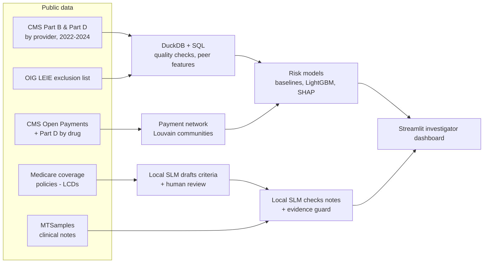

# Medicare Payment Integrity Copilot

An end-to-end, explainable AI system for health-plan payment integrity, built only on free public data:

1. **Provider risk engine:** ranks 1.8 million Medicare providers for audit, validated against providers the HHS Office of Inspector General later excluded.
2. **Industry-payment network:** links providers to the drug and device companies that pay them (Open Payments) and tests whether that money predicts exclusion.
3. **Documentation checker:** a small language model running locally checks clinical notes against Medicare coverage policies, quoting the note as evidence, and was measured against blind human review.
4. **Investigator dashboard:** a risk queue, per-provider reasons, documentation checks with highlighted evidence, and model performance.

> Risk scores and coverage verdicts are statistical signals to help a human reviewer prioritize work. They are **not** evidence of fraud or wrongdoing.

## Results at a glance

| Component | Result |
| --- | --- |
| Provider risk model (LightGBM, test year 2024) | **75–94× better than random** at finding providers later excluded for fraud in the top 1,000; ROC-AUC 0.79–0.83 |
| Simple baselines (top-1% rules, Isolation Forest) | Close to random (ROC-AUC 0.54–0.60): being unusual is not the same as being fraudulent |
| Industry payments (Open Payments) | No meaningful difference between later-excluded providers and everyone else (43.5% vs 43.9% receive payments) |
| Policy → criteria (local SLM + human review) | 98 criteria drafted, **26 kept** after review; 17 invented quotes caught automatically |
| Documentation checker, 3B model | 36.7% raw agreement with the human reviewer → **67.5% after the evidence guard** |
| Documentation checker, 7B model | **88.3%** agreement (Cohen's κ 0.74) at ~22 s per note on a MacBook Air |

## Architecture



## 1. Data

| Source | Rows | Use |
| --- | --- | --- |
| CMS Medicare Physician & Other Practitioners, by provider (2022–2024) | 1.23–1.30 M per year | Billing behavior |
| CMS Medicare Part D Prescribers, by provider (2022–2024) | 1.33–1.42 M per year | Prescribing behavior |
| OIG List of Excluded Individuals/Entities (LEIE) | 84,093 | Labels |
| CMS Open Payments, general payments (2022–2024) | aggregated per doctor, company, product | Industry money |
| CMS Part D Prescribers, by provider and drug (2022–2024) | brand-name drugs only | Pay-to-prescribe alignment |
| Medicare Coverage Database, current LCDs | 4 policies selected | Coverage rules |
| MTSamples (Kaggle) | 59 procedure notes | Clinical documentation |

**Data quality** (`reports/data_quality.md`): zero invalid or duplicate NPIs across 7.9 million billing rows. Only **10.6% of exclusion records carry an NPI**, so just 865 excluded providers can be matched to billing data, and 802 of them billed *before* their exclusion. Those 802 are the only labels that can be used without leakage.

**Access note:** data.cms.gov blocks traffic from outside the US, so the download notebooks in `notebooks/` run on Google Colab and save compact Parquet files.

## 2. Provider risk engine

**Features** (`src/features/build_features.py`): 26 behavior features per provider per year, covering Part B payment and services per patient, charge inflation, repetitive billing, Part D cost and days' supply per claim, brand-name, low-income-subsidy and opioid shares, and year-over-year growth. Each feature is also expressed as a **percentile and a robust z-score within the provider's peer group** (same specialty and state, or specialty nationally when the state group has fewer than 30 providers). In total that's 5.2 million provider-years.

**Labels without leakage:** a provider-year from year *T* is positive if the provider was excluded in *T+1* or *T+2*. Providers already excluded in or before *T* are dropped. The model trains on 2022–2023 and is tested on **every one of the 1.79 million providers in 2024**.

| Label | Train positives | Test positives (2024) |
| --- | --- | --- |
| Fraud-related exclusions (1128a1, a3, b1, b7) | 285 | 95 (1 in 18,855) |
| Any exclusion | 662 | 287 (1 in 6,241) |

**Results, fraud-related label, test year 2024** (`reports/model_eval*.md`):

| Model | ROC-AUC | PR-AUC | Hits in top 1,000 | Lift @1,000 | Recall in top 10,000 |
| --- | --- | --- | --- | --- | --- |
| Random ranking | 0.50 | 0.0001 | ~0.05 | 1× | 0.6% |
| Rule baseline (count of top-1% features) | 0.54 | 0.0001 | 0 | 0× | 2.1% |
| Isolation Forest (unsupervised) | 0.58 | 0.0001 | 0 | 0× | 2.1% |
| LightGBM v1: behavior + specialty | 0.83 | 0.0021 | 5 | 94× | 14.7% |
| LightGBM v2: behavior only | 0.81 | 0.0036 | 4 | 75× | 8.4% |
| **LightGBM v3: behavior + payments (final)** | **0.79** | **0.0091** | **5** | **94×** | **9.5%** |

**Why v2/v3 drop specialty:** in v1, specialty was the strongest input, so the top-ranked providers were flagged with reasons like "specialty = Internal Medicine", which an investigator can't act on. Peer normalization already accounts for specialty, so v2 and v3 use only behavior. Every reason is something to check, for example *"days supplied per claim = 87 (top 1% of peers)"*. With only 95 test positives, the differences between v1–v3 are within noise.

**What the model learns:** the strongest signals are Part D behavior (low-income-subsidy share, days' supply per claim, cost per claim, claims per patient) and Part B charge inflation and services per patient. Several top-ranked providers show a **sudden collapse in Medicare activity**. That often means an investigation or payment suspension had already begun, so the model's real lead time is shorter than the numbers suggest.

## 3. Industry-payment network

`src/graph/build_graph_features.py` adds 10 features per provider-year: total and high-value payments (consulting, speaker fees, royalties, ownership), number of paying companies, concentration on the top payer, **share of brand-name prescriptions for drugs made by companies that paid the provider**, and Louvain communities in the company–provider network of high-value payments.

| Group (train years) | Receives any payment | Median $ if paid | Receives high-value payments |
| --- | --- | --- | --- |
| Later excluded for fraud | 43.5% | $242 | 3.2% |
| Everyone else | 43.9% | $181 | 3.0% |

**Finding:** industry money doesn't distinguish providers later excluded for fraud. That's plausible: most fraud exclusions are for criminal convictions and controlled substances rather than kickbacks, and Open Payments records *legal, disclosed* payments. The network is still useful as **investigation context** for a provider already flagged.

## 4. Documentation checker (local SLM)

The second stage of an audit is medical review: does the record support what was billed? This part uses a **local small language model via Ollama**, so no clinical text leaves the machine, as real HIPAA constraints would require.

**Procedures and policies:**

| Procedure | Medicare policy (LCD) | Notes |
| --- | --- | --- |
| Cataract surgery | L34203 | 23 |
| Facet joint interventions | L33930 | 8 |
| Epidural steroid injections | L39240 | 20 |
| Blepharoplasty (eyelid surgery) | L34194 | 8 |

**Step 1: policy → criteria** (`src/coverage/draft_criteria.py`). The SLM reads each policy in chunks and drafts criteria, each with a quote. An **evidence guard** rejects any quote that doesn't appear word for word in the policy: 17 of 126 drafted quotes were invented. A human review (`labels/criteria_review.md`) then kept **26 of 98** criteria and wrote a **decision rule** per procedure. The review found:
- 12 real quotes taken from the policy's *definitions* section and wrongly turned into requirements
- 7 real quotes that support a *different* statement than the criterion claimed
- 6 rules that need a year of claims history and can't be checked from one note

*A verified quote proves the text exists, not that the model understood it.*

**Step 2: note → verdict** (`src/coverage/check_coverage.py`). Each criterion becomes a plain yes/no question (*"Was IV sedation, MAC or general anesthesia used?"*). The model answers and must quote the note; the **code** decides what the answer means. Small models handle double negatives badly, so polarity is never left to the model. Each note gets one verdict:
- **MEETS_COVERAGE:** the decision rule is satisfied
- **DOCUMENTATION_DEFICIT:** required evidence is missing
- **UNSUPPORTED:** the note explicitly contradicts a requirement, for example IV sedation where the policy says it is not medically necessary

**Verdicts (qwen2.5 7B, 59 notes):** 10 meet coverage, 38 documentation deficit, 11 unsupported. The 11 unsupported are mostly facet and epidural notes that document IV sedation or MAC. Most deficits are cataract and eyelid operative notes that don't repeat the pre-operative findings (visual impairment, photographs) that the policy asks for. In a real audit those would be requested from the pre-op record.

**Evaluation against blind human review** (`src/coverage/label_app.py`, `reports/coverage_eval*.md`). 120 questions across 56 notes were labeled by a human reviewer who couldn't see the model's answers. The sample deliberately includes **every** answer the checker turned into a contradiction and every answer the evidence guard rejected, so it's harder than a random sample.

| | llama3.2 3B | qwen2.5 7B |
| --- | --- | --- |
| Raw answers vs human | 36.7% (κ 0.20) | **88.3% (κ 0.74)** |
| After the evidence guard | **67.5% (κ 0.42)** | 88.3% (κ 0.72) |
| Criterion status vs human | 95.0% (κ 0.89) | 93.3% (κ 0.86) |
| False contradictions | 2 | 1 |
| Seconds per note (MacBook Air, 16 GB) | 19 | 22 |

**Takeaways:**
- The evidence guard **nearly doubles the 3B model's accuracy**: of 47 answers it rejected, 42 were wrong.
- The 7B model reads notes far better at almost the same speed, so it is the default.
- Status accuracy is high for both partly because the most common error (answering "no" when the note is silent) doesn't change the decision for required findings.
- Remaining errors are clinical nuance. *"The patient was lightly sedated"* was read as prohibited sedation (minimal sedation is allowed), and two lumbar levels (L5-S1 and L4-5) were read as two spinal regions.

## 5. Investigator dashboard

`streamlit run app/app.py`

- **Risk queue:** top providers for a chosen review capacity, filterable by state and specialty, with the top two reasons. Provider IDs are masked by default.
- **Provider case view:** the five strongest reasons, each with the provider's peer percentile.
- **Documentation check:** verdicts by procedure, each criterion with its quoted evidence, rejected quotes shown crossed out, and the note with evidence highlighted.
- **Model performance:** the risk model and documentation checker evaluations.

## Limitations

- **Labels are rare and noisy.** Only 10.6% of exclusions have an NPI, not every exclusion is billing fraud, and most fraud is never caught. Results show *prioritization*, not proof.
- **Few positives.** With 95 fraud cases in the test year, model differences of a few hits are within noise.
- **Aggregated billing data.** CMS publishes yearly totals per provider, not individual claims, so claim-level patterns such as upcoding by code aren't visible in this version.
- **Privacy suppression.** CMS hides counts under 11, so features such as long-acting opioid share are missing for most providers.
- **Clinical notes are not linked to providers.** MTSamples are public sample notes; stage 2 demonstrates the medical-review workflow on documentation in general.
- **Operative notes only.** Coverage often depends on pre-operative records, so many "deficits" reflect missing context rather than missing care.
- **One human reviewer.** Agreement is measured against a single non-clinician reviewer.

## Responsible use

- Scores and verdicts support human reviewers; they never make a final determination.
- Provider identifiers are masked in the dashboard and kept out of reports. No list of named "high-risk" providers is published.
- All clinical text is processed by a local model; nothing is sent to external AI services.

## How to run

Requires Python 3.12, [Ollama](https://ollama.com) and, on macOS, `brew install libomp`.

```bash
python -m venv .venv && source .venv/bin/activate
pip install -r requirements.txt

# 1. Data: run the notebooks in notebooks/ on Google Colab, unzip the outputs into data/
#    and download MTSamples (mtsamples.csv) from Kaggle into data/raw/mtsamples/
python src/quality/check_quality.py
python src/features/build_features.py
python src/graph/build_graph_features.py
python src/models/train_models.py

# 2. Documentation checker
ollama pull qwen2.5:7b
python src/coverage/prepare_coverage.py
python src/coverage/draft_criteria.py          # then review labels/criteria_*.json by hand
python src/coverage/check_coverage.py --model qwen2.5:7b --tag qwen7b
streamlit run src/coverage/label_app.py        # blind human labels
python src/coverage/evaluate_coverage.py --tag qwen7b

# 3. Dashboard
streamlit run app/app.py
```

## Repository structure

```
notebooks/        Colab notebooks that download and compact the public data
src/quality/      data-quality checks
src/features/     peer-normalized features and leakage-free labels
src/graph/        Open Payments and network features
src/models/       baselines, LightGBM, SHAP reasons
src/coverage/     policy criteria, SLM checker, labeling app, evaluation
labels/           reviewed criteria, decision rules, human labels
reports/          every result table quoted in this README
app/              Streamlit investigator dashboard
```

## Tech stack

Python · DuckDB · pandas · scikit-learn · LightGBM · NetworkX (Louvain) · Ollama (llama3.2 3B, qwen2.5 7B) · Streamlit

## Future work

- Claim-level billing data (CMS "by Provider and Service") for code-level upcoding checks
- Neo4j for interactive network investigation of flagged providers
- Pre-operative notes and more procedures for the documentation checker
- Several clinical reviewers, to measure inter-rater agreement
